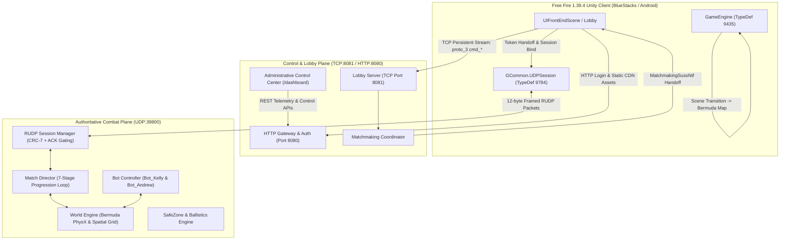

# IND PROJECT Control Center — Free Fire 2019 Restoration (1.39 India V1)

> **Authentic Dual-Plane Game Server & macOS-Inspired Administrative Control Center**  
> Complete restoration of Free Fire 1.39.4 (Barbosa OB17, IL2CPP Unity 2018.4 on Android x86/ARM) featuring authoritative TCP/UDP protocol engines, 266-opcode combat subsystem, and a dark glass administrative studio.

[](tests/)
[](https://www.python.org/)
[-cyan?style=flat-square)](docs/protocol/)
[](static/dashboard/)
[](LICENSE)

---

## 1. Architectural Overview

IND PROJECT implements an asymmetric dual-plane architecture designed to emulate the authentic 2019 production environment:



### Network Topology & Port Bindings

| Subsystem | Port / Transport | Protocol & Framing | Primary Responsibilities |
|:---|:---:|:---|:---|
| **HTTP Gateway** | `8080` (HTTP/REST) | JSON / Protobuf / Static CDN | Account authentication, patch manifests, asset routing, Control Center SPA host (`/dashboard`), REST APIs. |
| **TCP Lobby Server** | `8081` (TCP) | Length-prefixed binary stream (`proto_3`) | Persistent command multiplexing (`cmd_*`), real-time inventory synchronization, friend presence, and matchmaking coordinator. |
| **UDP Combat Plane** | `39800` (RUDP) | 12-byte framed RUDP (CRC-7 integrity) | 266-opcode Barbosa binary protocol, sliding-window ACK gating, authoritative player/bot movement, safe zone contraction, hit registration. |

---

## 2. Control Center Administrative Dashboard (`/dashboard`)

The application features a single-page administrative control center built with a dark glass design system:

- **Unified Glassmorphism:** CSS variables (`tokens.css`), custom blur backdrops, crisp borders, and zero consumer emojis (100% Lucide outline SVG geometry).
- **Zero Page Jumps:** In-place workspace navigation mounting dynamically into `#workspace-canvas`.
- **Reactive Player Context:** Synchronized account selector binding across all functional domains.

### Functional Workspaces

```
static/dashboard/src/modules/
├── overview/
│   ├── main.js                 # Unified telemetry strip (HTTP 8080, TCP 8081, UDP 39800), live metrics & wire packet stream
│   └── monitoring.js           # Real-time network throughput, active sockets & wire protocol breakdown
├── players/
│   ├── directory.js            # Paginated player fleet directory & search
│   ├── inspector.js            # Comprehensive player dossier, statistics, and rank management
│   ├── account.js              # Account parameter mutation & state editor
│   ├── bans.js                 # Security ban ledger, suspension levels, and device blacklisting
│   └── sessions.js             # Active connection audit & force-disconnect controls
├── inventory/
│   ├── manager.js              # Universal inventory & item grant console
│   ├── characters.js           # Character roster, skills, and fragment upgrading
│   ├── pets.js                 # Pet catalog, pet levels, and custom skill bindings
│   └── wardrobe.js             # Cosmetic skins, outfits, weapons, and vault inventory
├── economy/
│   ├── currencies.js           # Multi-currency ledger (Gold, Diamonds, Badges, Vouchers)
│   └── wallet.js               # Real-time balance editor, grant system & audit trails
├── luck-royale/
│   ├── machines.js             # Remediated Unified Studio Console (Diamond, Weapon, Gold, Incubator)
│   ├── common.js               # Shared gacha utilities, rarity badges, and 19-character debris mapping
│   ├── pools.js                # Authoritative drop probability & prize pool matrix
│   ├── artwork.js              # Artwork slots matrix & slide-over asset assignment drawer
│   ├── pity.js                 # Lucky meter thresholds & guaranteed pity ceiling manager
│   ├── events.js               # Gacha campaigns, discount rates, and promotional schedules
│   ├── forge.js                # Incubator blueprint and evolution stone crafting
│   └── simulator.js            # Monte Carlo probability simulator & distribution analyzer
├── game/
│   ├── modes.js                # Classic, Ranked, Clash Squad, and custom match modes
│   ├── maps.js                 # Bermuda, Purgatory, and Kalahari map configurations
│   ├── matchmaking.js          # Queue parameters, rating algorithms, and bot backfill ratios
│   └── rooms.js                # Custom room lobby administration & spectator slots
├── social/
│   ├── mail.js                 # System inbox, player messaging, and reward attachments
│   ├── friends.js              # Relationship graphs, pending requests, and presence states
│   └── squads.js               # Guild management, squad matchmaking, and roster controls
└── system/
    ├── database.js             # SQLite telemetry, table browser, vacuum & maintenance
    ├── security.js             # Encryption keys, TEA crypto validation, and token inspection
    └── settings.js             # Global server configurations, port bindings, and logging levels
```

---

## 3. Authentic Free Fire 1.39 Asset Pipeline

All visual assets rendered in the Control Center are extracted from original 1.39 game resources (Unity asset bundles and sprites):

- **Reward Items & Vouchers:** 78 authoritative items matched 1:1 against `scratch/Item_authoritative.csv`.
- **Character Debris:** 19 character debris items (`debris_800000001.png` - `debris_800000019.png`).
- **Royale Posters & Banners:** Authentic Diamond, Weapon, Gold, and Incubator posters.
- **Turntable UI:** 16 turntable UI elements, background ramps, and probability indicators.
- **Authoritative Manifest:** Complete JSON manifest catalog at `static/assets/freefire/1.39/manifest.json`.

---

## 4. Getting Started

### Prerequisites

- Python 3.10 or higher
- Modern Chromium-based browser (Chrome, Edge)
- SQLite3

### Installation

1. **Clone the repository:**
   ```bash
   git clone https://github.com/Adi1083/legacy-server.git
   cd legacy-server
   ```

2. **Install Python dependencies:**
   ```bash
   pip install -r requirements.txt
   ```

3. **Start the Unified Server:**
   ```bash
   python server.py
   ```
   *Starts the HTTP Gateway (8080), TCP Lobby Server (8081), and UDP Combat Plane (39800).*

4. **Access the Administrative Dashboard:**
   Open your browser to:
   ```text
   http://localhost:8080/dashboard
   ```

---

## 5. Automated Testing & Verification

The repository maintains an automated regression test suite:

```bash
# Run server backend unit and regression tests (58 tests)
python tests/run_all_tests.py

# Run dashboard SPA integration and design system tests (71 tests)
python tests/dashboard/run_dashboard_tests.py
```

### Test Coverage Matrix

```
======================================================================
IND PROJECT CONTROL CENTER — QA & REGRESSION SUMMARY
======================================================================
Dashboard Master Suite (run_dashboard_tests.py):  71/71 PASS (100.0%)
  • 01_SPA_Route_Coverage                       (5 tests)
  • 02_Player_Context_Reactivity                (3 tests)
  • 03_UI_Design_System_Factory                 (5 tests)
  • 04_HTML_Shell_Asset_Integrity               (5 tests)
  • 05_Backend_API_Integration                  (18 tests)
  • 06_Responsive_Viewport_Validation           (5 tests)
  • 07_Overview_Module_Validation               (5 tests)
  • 08_Monitoring_Module_Validation             (5 tests)
  • 09_Players_Module_Validation                (5 tests)
  • 10_Inventory_Module_Validation              (5 tests)
  • 11_Economy_Module_Validation                (5 tests)
  • 12_Luck_Royale_Module_Validation            (5 tests)

Server Core QA Suite (run_all_tests.py):          58/58 PASS (100.0%)
  • 01_Machine_Config                           (9 tests)
  • 02_Spin_Execution                           (7 tests)
  • 03_Economy_&_Balance                        (9 tests)
  • 04_Reward_&_Gacha_Logic                     (6 tests)
  • 05_Incubator_Forge                          (7 tests)
  • 06_Admin_API_&_Dashboard                    (10 tests)
  • 07_Persistence_&_Recovery                   (5 tests)
  • 08_Core_Regression                          (5 tests)
----------------------------------------------------------------------
TOTAL AUTOMATED TEST CASES:                      129/129 PASS (100% CLEAN)
Interactive Browser Console Errors:              0
Viewport Horizontal Overflows:                   0px (1080p, 900p, 768p)
Gold Royale 19-Character Debris Mapping:         100% PRESERVED & PROTECTED
======================================================================
```

---

## 6. Directory Structure

```
server/
├── combat/                     # UDP combat plane, RUDP engine, 266-opcode codec, bot AI
├── core/                       # State management, SQLite database layer, player session registry
├── data/                       # Authoritative databases, machine configs, CMS content
├── docs/                       # Architecture diagrams, combat reverse-engineering, forensic audits
├── handlers/                   # HTTP REST handlers, game router, and admin studio APIs
├── proto/                      # Protobuf and binary packet data structures
├── static/
│   ├── assets/freefire/1.39/   # Extracted authentic game sprites, items, debris & manifest
│   └── dashboard/              # Control Center SPA frontend (Apple Dark Glass design system)
├── tests/                      # Full automated unit, integration, and UI test suites
├── server.py                   # Master process bootstrapper (HTTP + TCP + UDP)
└── tcp_server.py               # Standalone TCP lobby server daemon
```

---

## 7. License & Attribution

Restoration project for Free Fire 1.39.4 (2019 India V1 Barbosa OB17). Built for archival, reverse-engineering research, and private emulation purposes.
