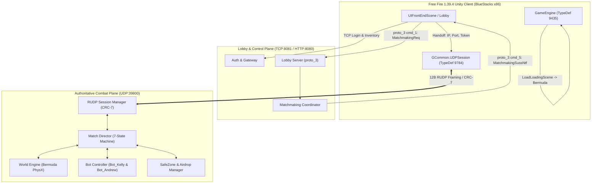

# Free Fire 1.39 India V1 - Master Architecture & Technical Specifications

Authoritative technical documentation, architecture diagrams, protocol specifications, and reverse-engineering audits for Free Fire 1.39.4 (IND PROJECT OB17, IL2CPP Unity 2018.4 on Android x86/ARM).

---

## 1. Documentation Index & Sitemap

```
docs/
├── README.md                                  # Master index and global system architecture map
├── match_flow/
│   └── MATCH_PROGRESSION_FLOW.md             # 7-stage match lifecycle: Lobby -> Cake -> Island -> Plane -> Parachute -> Combat -> Booyah
├── combat/
│   └── AUTHENTIC_COMBAT_SUBSYSTEM.md         # IND PROJECT 266-opcode catalog, binary wire codecs, bot AI loops & ballistics
├── reverse_engineering/
│   └── MATCH_CRASH_AUDIT.md                  # Forensics on SIGABRT, SIGSEGV 0x0, MatchmakingSussNtf, GameEngine, & mUseAB
├── protocol/                                  # Protobuf & TCP/UDP packet schemas (in progress)
└── architecture/                              # Server topology, Unity native bridge, threading model (in progress)
```

---

## 2. Server Topology & Component Map

The Free Fire 1.39 backend comprises an asymmetric dual-network topology:
1. **Control & Lobby Plane (TCP / TLS / HTTP)**:
   - **Gateway / Auth Server (`127.0.0.1:8080`)**: Account authentication, guest binding, version checks, CDN patch manifests.
   - **Lobby TCP Server (`127.0.0.1:8081`)**: Persistent command multiplexing (`proto_3/cmd_*`), inventory synchronization, friend presence, and matchmaking queue coordinator.
2. **Authoritative Combat Plane (UDP RUDP / PhysX)**:
   - **Combat RUDP Server (`127.0.0.1:39800`)**: Custom reliable UDP protocol, 12-byte framing, CRC-7 integrity, sliding-window ACK gating, authoritative player/bot movement, safe zone contraction, and combat hit registration. *(Note: UDP combat networking is actively started, but is work in progress and not yet accurate).*



---

## 3. Core Subsystem Highlights

### 3.1 Match Progression State Machine
Detailed in [`match_flow/MATCH_PROGRESSION_FLOW.md`](file:///d:/MY%20WORK/RESOURCES/LEGACY/LEGACY/docs/match_flow/MATCH_PROGRESSION_FLOW.md):
- **Stage 0 (Lobby START)**: Matchmaking enqueue and `MatchmakingSussNtf` handoff.
- **Stage 1 (Cake Loading)**: `GameEngine.LoadLoadingScene` asynchronous asset decompression and shader warmup.
- **Stage 2 (Bermuda Spawn Island)**: 60-second waiting island countdown, RUDP initial state sync (Opcodes 130, 101, 116).
- **Stage 3 (Airplane Flight Path)**: Authoritative flight trajectory vector across Bermuda (Opcode 110 `RUDP_BATTLE_START`).
- **Stage 4 (Ejection & Parachute Jump)**: Skydiving freefall, canopy deployment, and altitude glide (Opcode 443 `RUDP_TeamParachuteInfo`).
- **Stage 5 (Active Combat & 2-Bot AI)**: Authoritative combat loop with `Bot_Kelly` and `Bot_Andrew` executing navigation, looting, cover, and hit validation.
- **Stage 6 (Booyah! Victory & Settlement)**: Match completion (Opcode 103 `RUDP_MATCH_END`), damage summary, and MMR rating calculations.

### 3.2 Authentic Combat Subsystem (IND PROJECT Combat Engine)
Detailed in [`combat/AUTHENTIC_COMBAT_SUBSYSTEM.md`](file:///d:/MY%20WORK/RESOURCES/LEGACY/LEGACY/docs/combat/AUTHENTIC_COMBAT_SUBSYSTEM.md):
- **Complete 266-Opcode Roster**: Wire enum mapping extracted from `global-metadata.dat` (`message.hTKYY D`, TypeDef [4464]).
- **Wire Codec Specifications**: Byte-level binary memory layouts for Opcode 130 (`S2C_JoinMatchRes`, 89B), Opcode 101 (`S2C_PlayerJoin`, 116B+), Opcode 116 (`S2C_SyncSceneInfo`, 36B), and Opcode 1014 (`UDP_PlayerPositionOnly`).
- **Bot Behavior Loop**: Finite state machine controlling `Bot_Kelly` (Avatar 101000006) and `Bot_Andrew` (Avatar 102000005) across waypoints, line-of-sight targeting, weapon recoil simulation, and inventory management.
- **Zone Mathematics**: Concentric circle shrink equations, damage intervals, and warning radius interpolations.

### 3.3 Reverse Engineering Audits
Detailed in [`reverse_engineering/MATCH_CRASH_AUDIT.md`](file:///d:/MY%20WORK/RESOURCES/LEGACY/LEGACY/docs/reverse_engineering/MATCH_CRASH_AUDIT.md):
- **Slice 1: MatchmakingSussNtf Deserializer**: IL2CPP TypeDef [5877] (line 123084), field order verification, and 12-property object schema.
- **Slice 2: GameEngine Async Execution**: `LoadLoadingScene` (Method [70853]), `LoadAndRun` (Method [70847]), and coroutine iterator state desync analysis.
- **Slice 3: LevelObjectManager & `mUseAB`**: AssetBundle streaming dependencies vs built-in resources, resolving `SEGV_MAPERR 0x0` null-dereference crashes.
- **Slice 4: UICustomRoomController Router**: Route table isolation in `UINavigationUtil`, confirming the benign warning nature of `No Such Navigation COW.UICustomRoomController`.
- **Bionic libc SIGABRT Forensics**: Bugly crash-handler disassembly (`libBugly.so:0x5ab0`) passing kernel TID into `pthread_kill`, triggering abort `-6 (SI_TKILL)`.

---

## 4. Key Cross-References & Source Code Mapping

| Component | Repository Source File | IL2CPP Reference | Documentation Link |
| :--- | :--- | :--- | :--- |
| **Match Progression** | `server/combat/match_director.py` | `COW.MatchGame` [3480] | [`MATCH_PROGRESSION_FLOW.md`](file:///d:/MY%20WORK/RESOURCES/LEGACY/LEGACY/docs/match_flow/MATCH_PROGRESSION_FLOW.md) |
| **Combat Server** | `server/combat/udp_server.py` | `GCommon.UDPSession` [9784] | [`AUTHENTIC_COMBAT_SUBSYSTEM.md`](file:///d:/MY%20WORK/RESOURCES/LEGACY/LEGACY/docs/combat/AUTHENTIC_COMBAT_SUBSYSTEM.md) |
| **Combat Codecs** | `server/combat/combat_packet_codec.py`| `message.hTKYY D` [4464] | [`AUTHENTIC_COMBAT_SUBSYSTEM.md`](file:///d:/MY%20WORK/RESOURCES/LEGACY/LEGACY/docs/combat/AUTHENTIC_COMBAT_SUBSYSTEM.md) |
| **Bot Controller** | `server/combat/bot_controller.py` | `COW.BotAI` & `message.‚DL\|vmS` | [`AUTHENTIC_COMBAT_SUBSYSTEM.md`](file:///d:/MY%20WORK/RESOURCES/LEGACY/LEGACY/docs/combat/AUTHENTIC_COMBAT_SUBSYSTEM.md) |
| **Crash Hunter** | `dump/reports/crash_hunter_report.md`| `libBugly.so:0x5ab0` | [`MATCH_CRASH_AUDIT.md`](file:///d:/MY%20WORK/RESOURCES/LEGACY/LEGACY/docs/reverse_engineering/MATCH_CRASH_AUDIT.md) |
