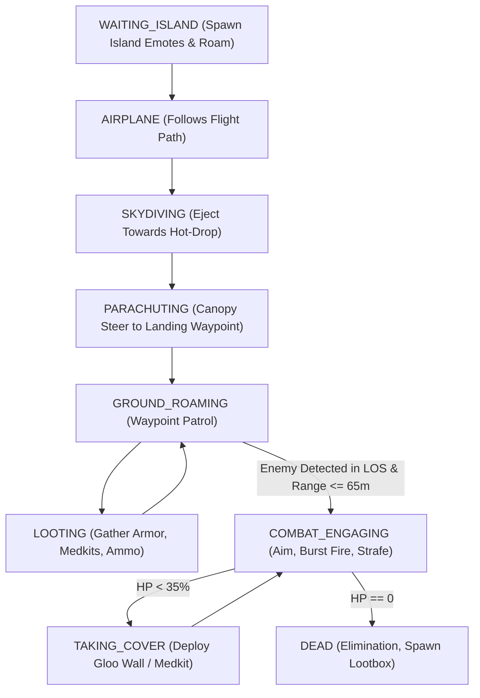

# Authentic Combat Subsystem Specification: Free Fire 1.39 (IND PROJECT Combat Engine)

Authoritative specification of the Free Fire 1.39 combat network architecture, 266-opcode IND PROJECT catalog, binary packet wire layouts, Safe Zone mathematics, and autonomous 2-bot controller loop.

> [!WARNING]
> **Implementation Status: Work In Progress (Not Yet Accurate)**  
> The authoritative UDP combat subsystem and binary packet dispatch loops have been initiated in initial experimental form, but are **not yet mechanically accurate**. Real-time player physics, hit verification, bot combat navigation, and packet timing synchronization are actively under development and reverse-engineering.

---

## 1. Network Transport Layer: GCommon IND PROJECT RUDP

The Free Fire 1.39 combat subsystem operates over custom Reliable UDP (`GCommon.UDPSession`, TypeDef [9784]) bound to port `39800`.

### 1.1 Header Structures & Framing
Every packet begins with a 1-byte magic key (`0x6C` = 108 decimal) and a 1-byte CRC-7 checksum. Depending on the `SendOption`, the header spans 5, 8, or 12 bytes.

#### Reliable Header (12 Bytes)
Used for critical game state transitions: `HELLO (1)`, `RELIABLE (2)`, and `VAR_RELIABLE (5)`.
```
 0                   1                   2                   3
 0 1 2 3 4 5 6 7 8 9 0 1 2 3 4 5 6 7 8 9 0 1 2 3 4 5 6 7 8 9 0 1
+-+-+-+-+-+-+-+-+-+-+-+-+-+-+-+-+-+-+-+-+-+-+-+-+-+-+-+-+-+-+-+-+
|  MsgKey (0x6C)|   CRC-7 (1B)  | SendOption(1B)|   Cmd (uint16_le)     |
+-+-+-+-+-+-+-+-+-+-+-+-+-+-+-+-+-+-+-+-+-+-+-+-+-+-+-+-+-+-+-+-+
|   SeqID (uint16_le)           |  OrderID (uint16_le)          |
+-+-+-+-+-+-+-+-+-+-+-+-+-+-+-+-+-+-+-+-+-+-+-+-+-+-+-+-+-+-+-+-+
|   Flags (1B)  |     Length (uint16_le)        | Payload...    |
+-+-+-+-+-+-+-+-+-+-+-+-+-+-+-+-+-+-+-+-+-+-+-+-+-+-+-+-+-+-+-+-+
```

#### Non-Reliable Header (8 Bytes)
Used for high-frequency position ticks (`NONE = 0`, `BYEBYE = 3`, `VAR = 4`) and all `UDP_ACK (Cmd=2)` packets.
```
 0                   1                   2                   3
 0 1 2 3 4 5 6 7 8 9 0 1 2 3 4 5 6 7 8 9 0 1 2 3 4 5 6 7 8 9 0 1
+-+-+-+-+-+-+-+-+-+-+-+-+-+-+-+-+-+-+-+-+-+-+-+-+-+-+-+-+-+-+-+-+
|  MsgKey (0x6C)|   CRC-7 (1B)  | SendOption(1B)|   Cmd (uint16_le)     |
+-+-+-+-+-+-+-+-+-+-+-+-+-+-+-+-+-+-+-+-+-+-+-+-+-+-+-+-+-+-+-+-+
|   Flags (1B)  |     Length (uint16_le)        | Payload...    |
+-+-+-+-+-+-+-+-+-+-+-+-+-+-+-+-+-+-+-+-+-+-+-+-+-+-+-+-+-+-+-+-+
```

### 1.2 CRC-7 Integrity Algorithm
- **Polynomial**: $x^7 + x^3 + 1 = 0x09$ (`GCommon.UDPChecksum`, TypeDef [9765]).
- **Scope**: Computed over bytes starting at offset 2 (`SendOption`) through the payload end. Offsets 0 (`MsgKey`) and 1 (`CRC7` field) are skipped.
- **Python Reference**:
  ```python
  def calculate_crc7(data: bytes, initial: int = 0) -> int:
      crc = initial & 0x7F
      for b in data:
          idx = ((crc << 1) ^ b) & 0xFF
          crc = CRC7_TABLE[idx] & 0x7F
      return crc
  ```

---

## 2. Authentic 266 IND PROJECT Opcode Catalog

Extracted from IL2CPP metadata v23 (`message.hTKYY D`, TypeDef [4464]). Wire enum values represent the authentic network identifiers processed in Unity switch statements.

| Index | Field ID | Wire Opcode | Enum Name | Functional Category |
| :---: | :---: | :---: | :--- | :--- |
| **0** | 23036 | - | `value__` | Enum Base |
| **1** | 23037 | **100** | `RUDP_JOIN_MATCH` | Lifecycle & Session |
| **2** | 23038 | **101** | `RUDP_PLAYER_JOIN` | General Combat |
| **3** | 23039 | **102** | `RUDP_PLAYER_QUIT` | General Combat |
| **4** | 23040 | **103** | `RUDP_MATCH_END` | Lifecycle & Session |
| **5** | 23041 | **104** | `RUDP_START_FIRE` | Weaponry & Combat |
| **6** | 23042 | **105** | `RUDP_STOP_FIRE` | Weaponry & Combat |
| **7** | 23043 | **106** | `RUDP_TAKE_DAMAGE` | Weaponry & Combat |
| **8** | 23044 | **107** | `RUDP_DEAD` | Weaponry & Combat |
| **9** | 23045 | **108** | `RUDP_CHANGE_INVENTORY_ON_HAND` | Inventory & Items |
| **10** | 23046 | **109** | `RUDP_OPEN_DOOR` | World Interaction |
| **11** | 23047 | **110** | `RUDP_BATTLE_START` | Lifecycle & Session |
| **12** | 23048 | **111** | `RUDP_PICKUP_INVENTORY` | Inventory & Items |
| **13** | 23049 | **112** | `RUDP_DROP_INVENTORY` | Inventory & Items |
| **14** | 23050 | **113** | `RUDP_USE_INVENTORY` | Inventory & Items |
| **15** | 23051 | **114** | `RUDP_ADD_PICKUP` | Inventory & Items |
| **16** | 23052 | **115** | `RUDP_DEL_PICKUP` | Inventory & Items |
| **17** | 23053 | **116** | `RUDP_SYNC_SCENE_INFO` | Lifecycle & Session |
| **18** | 23054 | **117** | `RUDP_SAFE_ZONE_CHANGE` | World & Zones |
| **19** | 23055 | **118** | `RUDP_BIND_PRI` | Weaponry & Combat |
| **20** | 23056 | **119** | `RUDP_EQUIP` | Inventory & Items |
| **21** | 23057 | **120** | `RUDP_UNEQUIP` | Inventory & Items |
| **22** | 23058 | **121** | `RUDP_EQUIPMENT_CHANGED` | Inventory & Items |
| **23** | 23059 | **122** | `RUDP_EQUIP_ATTACHMENT` | Inventory & Items |
| **24** | 23060 | **123** | `RUDP_UNEQUIP_ATTACHMENT` | Inventory & Items |
| **25** | 23061 | **124** | `RUDP_ATTACHMENT_CHANGED` | Inventory & Items |
| **26** | 23062 | **125** | `RUDP_GETON_VEHICLE` | Vehicles |
| **27** | 23063 | **126** | `RUDP_GETOFF_VEHICLE` | Vehicles |
| **28** | 23064 | **127** | `RUDP_VEHICLE_TAKE_DAMAGE` | Vehicles |
| **29** | 23065 | **128** | `RUDP_VEHICLE_DEAD` | Vehicles |
| **30** | 23066 | **129** | `RUDP_FORCE_SYNC_VEHICLE_STATE`| Vehicles |
| **31** | 23067 | **130** | `RUDP_JOIN_MATCH_FINISHED` | Lifecycle & Session |
| ... | ... | ... | *(Opcodes 131 to 442 cataloged in `server/combat/COMBAT_OPCODE_CATALOG.md`)* | ... |
| **230**| 23266 | **443** | `RUDP_TeamParachuteInfo` | Parachute & Drop |
| **264**| 23300 | **274** | `RUDP_SHOW_MATCH_RESULT` | Settlement & Booyah |

---

## 3. High-Precision Binary Wire Codec Layouts

### 3.1 Opcode 130: `S2C_JoinMatchRes` (Exact 89 Bytes)
`TypeDef [4580]: message. nSa~rX`. Sent immediately following `RUDP_JOIN_MATCH` token validation.

```
0                   4                   12                  20
+-------------------+-------------------+-------------------+
|  err_code (4B)    |      match_id (uint64_le, 8B)         |
+-------------------+-------------------+-------------------+
|     account_id (uint64_le, 8B)        |  server_time (4B) |
+-------------------+-------------------+-------------------+
|map(1B)| wait_sec(4B)|weather(2B)|mode(4B)|room_type(4B)|
+-------+-------------+-----------+--------+-------------+  <- 39B Header
| phase (int16, 2B) |
+-------------------+-------------------+-------------------+
| Circle1 X (f32,4B)| Circle1 Y (f32,4B)| Circle1 Z (f32,4B)|
+-------------------+-------------------+-------------------+
| Circle1 R (f32,4B)| Circle2 X (f32,4B)| Circle2 Y (f32,4B)|
+-------------------+-------------------+-------------------+
| Circle2 Z (f32,4B)| Circle2 R (f32,4B)|                  <- 34B SafeZone
+-------------------+-------------------+-------------------+
| field11_cnt (4B=0)| field12_cnt (4B=0)| field13_cnt (4B=0)|
+-------------------+-------------------+-------------------+
| field14_val (4B=0)|                                      <- 16B Trailing
+-------------------+
Total: 39 + 34 + 16 = 89 Bytes
```

- **Struct Format String**: `<iQQIBiHii hffffffff iiii`
- **Field Breakdown**:
  - `err_code`: `0` (`ERR_NONE`).
  - `match_id`: `uint64` match handle.
  - `account_id`: `uint64` receiving player account ID.
  - `server_time`: `uint32` Unix timestamp.
  - `map_id`: `uint8` (`1` = Bermuda).
  - `waiting_seconds`: `int32` (`60`).
  - `weather_style`: `uint16` (`1`).
  - `game_mode`: `int32` (`1` = Classic Battle Royale).
  - `room_type`: `int32` (`0` = Default room).
  - `SafeZone Block (34B)`: `phase` (short), Current Circle ($x, y, z, r$), Next Circle ($x, y, z, r$).
  - `Trailing Trailing Fields (16B)`: 4x 32-bit zeros for `List<int>`, `List<uint>`, `List<Nested>`, and padding.

---

### 3.2 Opcode 101: `S2C_PlayerJoin` (Dynamic Binary Wire Layout)
`TypeDef [4579]: message.ae zaPn`. Dispatched to synchronize local human and simulated bot profiles into the scene.

- **Header Structure**:
  ```python
  # <QQBBQ: player_id(8B), account_id(8B), team_id(1B), camp(1B), match_id(8B) = 26 Bytes
  ```
- **Strings**: Encoded via .NET binary string protocol (1-byte length prefix + UTF-8 payload).
- **Clothes & Skills Arrays**:
  - `clothes`: `[4B count int32] + [8B * count uint64 item IDs]`.
  - `skills`: `[4B count int32] + [4B * count uint32 skill IDs]`.
- **Wire Packing Implementation**:
  ```python
  buf.extend(struct.pack("<QQBBQ", self.player_id, self.account_id, self.team_id, self.camp, self.match_id))
  buf.extend(encode_dotnet_string(self.nickname))
  buf.extend(struct.pack("<IBIIB", self.avatar_id, 1 if self.is_bot else 0, self.level, self.rank, 1 if self.is_ready else 0))
  buf.extend(struct.pack("<i", len(self.clothes)))
  for c in self.clothes: buf.extend(struct.pack("<Q", c))
  buf.extend(struct.pack("<BB", self.gender, 1 if self.is_alive else 0))
  buf.extend(struct.pack("<i", len(self.skills)))
  for s in self.skills: buf.extend(struct.pack("<I", s))
  buf.extend(encode_dotnet_string(self.region))
  buf.extend(struct.pack("<I", self.banner_id))
  buf.extend(encode_dotnet_string(self.headpic))
  ```

---

### 3.3 Opcode 116: `S2C_SyncSceneInfo` (Exact 36 Bytes)
`TypeDef [4580] variation: (RUDP_SYNC_SCENE_INFO = 116)`. Continuously broadcasts match countdown, player count, and island parameters.

- **Wire Layout**:
  - `match_id`: `uint64` (8 bytes)
  - `elapsed_time`: `float32` (4 bytes)
  - `countdown_seconds`: `float32` (4 bytes)
  - `alive_players`: `uint32` (4 bytes)
  - `spawn_island_x`: `float32` (4 bytes, `-500.0`)
  - `spawn_island_y`: `float32` (4 bytes, `10.0`)
  - `spawn_island_z`: `float32` (4 bytes, `800.0`)
  - `spawn_island_radius`: `float32` (4 bytes, `60.0`)
- **Struct Format String**: `<QffI ffff` (Total: $8 + 4 + 4 + 4 + 16 = 36$ Bytes).

---

## 4. Safe Zone Mathematics & Contraction Geometry

The Free Fire Bermuda battle space operates across a coordinate space of $[-1200, 1200]$ meters. The safe zone shrinks through 8 concentric circles defined in `SafeZoneManager` (`server/combat/safe_zone.py`).

### 4.1 Circle Contraction Formula
Given current safe zone circle $C_1 = (x_1, z_1, r_1)$ and target next circle $C_2 = (x_2, z_2, r_2)$, the next circle's center must strictly lie within the current radius:
$$\sqrt{(x_2 - x_1)^2 + (z_2 - z_1)^2} \le r_1 - r_2$$

During the contraction duration $T_{\text{shrink}}$, the active poison zone perimeter $C(t)$ at elapsed time $t$ interpolates linearly:
$$\mathbf{P}(t) = \mathbf{P}_1 + \left(\frac{t}{T_{\text{shrink}}}\right) (\mathbf{P}_2 - \mathbf{P}_1)$$
$$R(t) = r_1 + \left(\frac{t}{T_{\text{shrink}}}\right) (r_2 - r_1)$$

### 4.2 Phase Timing & Damage Configuration

| Phase | Wait Duration ($T_{\text{wait}}$) | Shrink Duration ($T_{\text{shrink}}$) | Start Radius ($r_1$) | End Radius ($r_2$) | Gas DPS (HP/sec) |
| :---: | :---: | :---: | :---: | :---: | :---: |
| **1** | 120s | 90s | 600m | 420m | 1.0 HP |
| **2** | 90s | 60s | 420m | 280m | 2.0 HP |
| **3** | 75s | 50s | 280m | 180m | 4.0 HP |
| **4** | 60s | 40s | 180m | 100m | 6.0 HP |
| **5** | 45s | 30s | 100m | 50m | 10.0 HP |
| **6** | 30s | 25s | 50m | 20m | 15.0 HP |
| **7** | 20s | 15s | 20m | 0m | 20.0 HP |

---

## 5. Autonomous 2-Bot AI Controller Loop

The authoritative combat server simulates exactly two bots alongside the human player, orchestrated by `BotController` (`server/combat/bot_controller.py`).

### 5.1 Bot Opponent Profiles

```
+------------------------------------+------------------------------------+
| Bot 1: "Bot_Kelly"                 | Bot 2: "Bot_Andrew"                |
+------------------------------------+------------------------------------+
| Player ID: 2                       | Player ID: 3                       |
| Account ID: 2000001                | Account ID: 2000002                |
| Avatar: 101000006 (Kelly)          | Avatar: 102000005 (Andrew)         |
| Gender: 1 (Female)                 | Gender: 2 (Male)                   |
| Clothes: [211000000, 203000059,    | Clothes: [211000000, 203000056,    |
|           204000046, 205000029]    |           204000043, 205000026]    |
| Primary Weapon: M4A1 (907000010)   | Primary Weapon: AK47 (907000013)   |
| Hot-Drop Target: Peak              | Hot-Drop Target: Bimasakti Strip   |
| Playstyle: Agile, Fast Sprint      | Playstyle: Defensive, High Armor   |
+------------------------------------+------------------------------------+
```

### 5.2 Bot Finite State Machine (FSM)



### 5.3 Ballistics & Recoil Math
When engaging in `COMBAT_ENGAGING`, bots calculate shooting vectors using Raycast trajectory logic (`server/combat/ballistics.py`):
1. **Direction Vector**:
   $$\mathbf{D} = \frac{\mathbf{P}_{\text{target}} - \mathbf{P}_{\text{bot}}}{\|\mathbf{P}_{\text{target}} - \mathbf{P}_{\text{bot}}\|}$$
2. **Hit Probability Model**:
   Given distance $d$, base weapon accuracy $A_w$, and bot difficulty factor $\mu \in [0.65, 0.85]$:
   $$P_{\text{hit}} = \mu \times A_w \times \left(1.0 - \frac{d}{120.0}\right)$$
3. **Body Part Selection**:
   - Head (10% probability): Damage multiplier $2.5\times$.
   - Chest/Torso (70% probability): Damage multiplier $1.0\times$.
   - Limbs (20% probability): Damage multiplier $0.75\times$.
4. **Packet Output**:
   When a hit succeeds, the server issues `RUDP_TAKE_DAMAGE` (Opcode 106) and subtracts health from the target entity.
