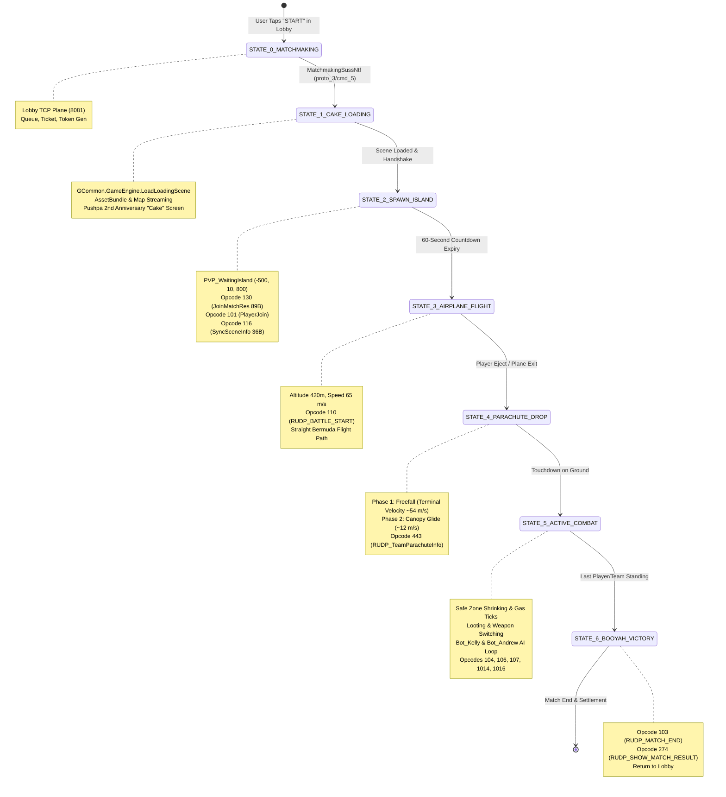

# Free Fire 1.39 Match Progression Flow Specification

Authoritative 7-stage match state machine, scene transitions, and packet synchronization sequence for Free Fire 1.39 (Barbosa OB17).

---

## 1. High-Level State Transition Architecture

The Free Fire 1.39 match lifecycle is governed by an authoritative 7-state progression model enforced by `MatchDirector` (`server/combat/match_director.py`) and executed by the Unity client through `COW.MatchGame` (TypeDef [3480]) and `GCommon.GameEngine` (TypeDef [9435]).



---

## 2. Comprehensive 7-Stage Breakdown

### Stage 0: Lobby START & Matchmaking Handshake
- **Network Layer**: TCP Client -> Lobby Server (`127.0.0.1:8081`).
- **Trigger**: Player taps the golden **START** button in `UIFrontEndScene`.
- **Packet Exchange Protocol**:
  1. **C2S `proto_3/cmd_1` (`EMatchmakingProto.MATCHMAKINGREQ`)**:
     - Client submits matchmaking ticket including player `account_id`, `nickname`, selected `game_mode = 1` (Battle Royale Classic), and team configuration (Solo = 1, Duo = 2, Squad = 4).
  2. **S2C `proto_3/cmd_2` (`EMatchmakingProto.MATCHMAKINGRES`)**:
     - Lobby acknowledges queue placement with `err_code = 0` (ERR_NONE).
  3. **S2C `proto_3/cmd_5` (`EMatchmakingProto.MATCHMAKINGSUSSNTF`)**:
     - Matchmaking engine allocates match slot and pushes the authoritative handoff descriptor (`tcp.MatchmakingSussNtf`, TypeDef [5877], line 123084 in `dump.cs`).
     - Key parameters passed to client:
       - `match_id`: Authoritative 64-bit integer (e.g., `10001`).
       - `server_addr`: Socket string (`"127.0.0.1:39800"`).
       - `secret`: Cryptographic session seed.
       - `prepare_token`: 32-character authentication token.
       - `map_id = 1`: Bermuda Island.
       - `game_mode = 1`: Standard Battle Royale.
       - `use_cache = false`: Instructs `LevelObjectManager` to stream directly from base assets.
       - `level_visual_style = 1`: Standard day weather.

---

### Stage 1: Cake Loading Screen (Asset Preload & Scene Warmup)
- **Engine Methods**: `GCommon.GameEngine.LoadLoadingScene` (Method [70853]), `GCommon.GameEngine.LoadAndRun` (Method [70847]), and `COW.MatchGame.OnAwake()` (Method [26181]).
- **Visuals**: Displays the Pushpa 2nd Anniversary celebration banner ("Cake" loading artwork) and loading progress bar.
- **Asynchronous Coroutine Loop**:
  - The Unity engine starts `<LoadLoadingScene>c__Iterator1` (TypeDef [9437]).
  - The client invokes `COW.MatchGame.SetSceneABInfo()`:
    - Verifies presence of `mSceneABPath` and `mStreamSceneAbPath`.
    - If `mUseAB` is false, loads terrain geometries and navmeshes from local static resources (`sharedassets4.assets`).
    - Initializes replication entities (`m_ReplicationEntitis`), game timer (`CurrentGameTimer`), and camera controllers (`CurrentCameraControllerManager`).
  - `UIFrontEndScene` unloads lobby UI view elements. The benign router warning `No Such Navigation COW.UICustomRoomController` is emitted during navigation stack teardown.
- **Completion Gate**: Once loading reaches 100%, the client transitions to scene `Bermuda` and initializes the combat UDP socket.

---

### Stage 2: Bermuda Spawn Island (`PVP_WaitingIsland`)
- **Coordinates**: Center `(-500.0, 10.0, 800.0)`, Radius `60.0m`.
- **Duration**: Exact 60-second synchronized countdown.
- **UDP Handshake & Sequence Execution**:
  1. **C2S `HELLO` (`SendOption=1, Cmd=1, Seq=1`)**:
     - Client opens UDP datagram connection to port `39800`.
  2. **S2C `S2C_Hello_Res` (`SendOption=1, Cmd=1`)**:
     - Server issues 4-byte session key and initializes the RUDP sliding window.
  3. **C2S `RUDP_JOIN_MATCH` (`Cmd=100`)**:
     - Client passes `prepare_token` and `account_id`.
  4. **S2C `UDP_ACK` (`Cmd=2`)**:
     - Server acknowledges packet receipt.
  5. **S2C `RUDP_JOIN_MATCH_FINISHED` (Wire Opcode 130, 89 Bytes)**:
     - Dispatches match attributes, initial safe zone circle (`center=(0,0,0)`, `radius=600m`), and countdown seconds (`60`).
  6. **S2C `RUDP_PLAYER_JOIN` (Wire Opcode 101, Multi-packet Dispatch)**:
     - Dispatched for the local human player and each active bot:
       - **Local Player**: ID `1`, `account_id=1000001`, selected avatar.
       - **Bot 1 (`Bot_Kelly`)**: ID `2`, `account_id=2000001`, Avatar `101000006` (Kelly), Level 28, Gold Rank.
       - **Bot 2 (`Bot_Andrew`)**: ID `3`, `account_id=2000002`, Avatar `102000005` (Andrew), Level 35, Platinum Rank.
  7. **S2C `RUDP_SYNC_SCENE_INFO` (Wire Opcode 116, 36 Bytes)**:
     - Continuously synchronizes countdown timer, alive players count (`3`), and spawn island perimeter.
- **Client Gameplay**: Players can sprint, punch, emote, and test jump physics without taking lethal damage.

---

### Stage 3: Airplane Flight Path Sequence
- **Trigger**: Spawn Island countdown hits `0.0s`.
- **Altitude**: Constant `420.0m` above Bermuda sea level.
- **Speed**: Authoritative straight flight at `65.0 m/s`.
- **Flight Trajectory Generation**:
  - The server selects entry and exit points on the Bermuda boundary:
    $$\text{Start} = (-1200.0, 420.0, -1200.0) \quad \longrightarrow \quad \text{End} = (1200.0, 420.0, 1200.0)$$
    $$\text{Distance} = \sqrt{\Delta x^2 + \Delta z^2} \approx 3394.11\,\text{m}$$
    $$\text{Duration} = \frac{3394.11\,\text{m}}{65.0\,\text{m/s}} \approx 52.2\,\text{seconds}$$
- **Server Dispatch**:
  - **S2C `RUDP_BATTLE_START` (Wire Opcode 110, 44 Bytes)**:
    - Provides trajectory start/end coordinates, flight speed, and duration.
  - The client switches camera to the cargo transport plane. The HUD displays the mini-map flight line and the **EJECT** button.

---

### Stage 4: Ejection & Parachute Sequence
- **Sub-Phases**:
  ```
  [Airplane Flight: 420m]
         │
         ▼  (Player taps Eject or forced exit at map boundary)
  [Skydiving Freefall: 420m -> 75m]  Velocity: -54.0 m/s, Forward: 25.0 m/s
         │
         ▼  (Altitude reaches 75m or manual canopy trigger)
  [Canopy Glide: 75m -> 0m]          Velocity: -12.0 m/s, Forward: 10.0 m/s
         │
         ▼  (Ground collision detected)
  [Landed Ground Roam]               Physics switches to PhysxState.WALKING
  ```
- **Packet Protocol**:
  - **S2C / C2S `RUDP_TeamParachuteInfo` (Wire Opcode 443, 33 Bytes)**:
    - Transmits `player_id`, `phase` (0=OnPlane, 1=Skydiving, 2=Parachuting, 3=Landed), `Vector3(x, y, z)`, `velocity_y`, `forward_speed`, and `yaw`.
- **Bot Drop Execution**:
  - `Bot_Kelly` targets hot-drop **Peak** (`Vector3(300.0, 45.0, 150.0)`).
  - `Bot_Andrew` targets hot-drop **Bimasakti Strip** (`Vector3(120.0, 20.0, 80.0)`).
  - Bots automatically eject at the nearest perpendicular trajectory point and steer towards designated landing coordinates.

---

### Stage 5: Active Combat & 2-Bot AI Loop
- **World State**: 1 Human Player + 2 Autonomous Simulated Opponents (`Bot_Kelly` and `Bot_Andrew`).
- **Authoritative Loops Running Concurrently**:
  1. **Safe Zone Contraction**:
     - Circles computed by `SafeZoneManager` (`server/combat/safe_zone.py`).
     - Dispatches `RUDP_SAFE_ZONE_CHANGE` (Wire Opcode 117).
     - Players and bots caught outside the white boundary suffer periodic poison gas damage.
  2. **High-Frequency Position & Aim Synchronization**:
     - Dispatches `UDP_PLAYER_POSITION_ONLY` (Opcode 1014, 21 Bytes) at 15–20 Hz.
     - Dispatches `UDP_SYNC_AIM_ROTATION` (Opcode 1016, 17 Bytes) tracking pitch and yaw.
  3. **Combat Engagements**:
     - **Shooting**: `RUDP_START_FIRE` (Opcode 104) and `RUDP_STOP_FIRE` (Opcode 105).
     - **Damage Ingestion**: `RUDP_TAKE_DAMAGE` (Opcode 106, 32 Bytes) specifying victim, attacker, weapon ID, and hit body part (1=Head [2.5x dmg], 2=Body [1.0x dmg], 3=Limbs [0.75x dmg]).
     - **Eliminations**: `RUDP_DEAD` (Opcode 107, 41 Bytes) triggering death animations and loot box spawning.

---

### Stage 6: Victory Booyah! Screen & Rank Settlement
- **Trigger**: `alive_players == 1` and all bot opponents are eliminated.
- **Packet Sequence**:
  1. **S2C `RUDP_MATCH_END` (Wire Opcode 103, 16 Bytes)**:
     - Signals combat engine freeze; disables weapon firing and damage timers.
  2. **S2C `RUDP_SHOW_MATCH_RESULT` (Wire Opcode 274)**:
     - Displays the iconic golden **BOOYAH!** victory splash.
     - Transmits kill count, total damage dealt, survived time, and rank score increments (+35 MMR points).
  3. **Disconnection & Lobby Return**:
     - Client dispatches `BYEBYE` (`SendOption=3, Cmd=4`).
     - Client teardowns UDP session and reconnects to the Lobby TCP plane.

---

## 3. Wire Opcode Cross-Reference for Match Flow

| Flow Stage | Packet Name | Wire Opcode | Struct Pack Format | Wire Size |
| :--- | :--- | :---: | :--- | :---: |
| **Stage 0** | `MatchmakingSussNtf` | `proto_3 / cmd_5` | Protobuf Payload | Variable |
| **Stage 2** | `RUDP_JOIN_MATCH_FINISHED` | `130` | `<iQQIBiHii hffffffff iiii` | **89 Bytes** |
| **Stage 2** | `RUDP_PLAYER_JOIN` | `101` | `<QQBBQ...` (Dynamic arrays) | **116+ Bytes** |
| **Stage 2** | `RUDP_SYNC_SCENE_INFO` | `116` | `<QffI ffff` | **36 Bytes** |
| **Stage 3** | `RUDP_BATTLE_START` | `110` | `<Q fff fff fff` | **44 Bytes** |
| **Stage 4** | `RUDP_TeamParachuteInfo` | `443` | `<IB fff fff I` | **33 Bytes** |
| **Stage 5** | `UDP_PLAYER_POSITION_ONLY` | `1014` | `<I fff f B` | **21 Bytes** |
| **Stage 5** | `RUDP_TAKE_DAMAGE` | `106` | `<II f B I B B fff` | **32 Bytes** |
| **Stage 5** | `RUDP_DEAD` | `107` | `<II...` (Packed kill record) | **41 Bytes** |
| **Stage 6** | `RUDP_MATCH_END` | `103` | `<Q I B B` | **16 Bytes** |
| **Stage 6** | `RUDP_SHOW_MATCH_RESULT` | `274` | `<Q I I I I` | **24 Bytes** |
